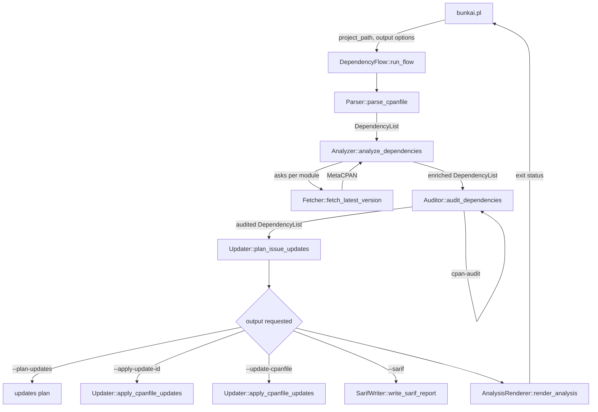

# Bunkai Architecture

Bunkai reads the declared dependencies of a Perl project, decides which are
outdated or vulnerable, and reports the verdict in the form the caller asked
for. This document describes how it is put together.

## Table of Contents

- [Design](#design)
- [Module Organization](#module-organization)
- [Program Flow](#program-flow)
- [Data](#data)
- [Component Reference](#component-reference)
- [Exit Status](#exit-status)

## Design

Every module is a component with a single entry point and no hidden state. A
component receives what it needs as arguments and returns what it produced;
it never reaches for a global, and it never reads the command line. The flow
that wires the components together lives in one place,
`Bunkai::Network::DependencyFlow`, so the order of work is readable in a single
subroutine rather than scattered across the modules that do it.

The boundaries are typed. `Bunkai::Types` declares the shapes that travel
between components as a `Type::Library`, and each component validates its
arguments with a `Type::Params` signature compiled once at load time. A caller
that passes the wrong shape is told so at the boundary it crossed, naming the
parameter, rather than failing somewhere deeper with a confusing message.

## Module Organization

| Module | Role |
| --- | --- |
| `Bunkai::Network::DependencyFlow` | the flow: decides the order of work |
| `Bunkai::Component::Parser` | reads the `cpanfile` |
| `Bunkai::Component::Analyzer` | compares declared versions against the latest |
| `Bunkai::Component::Fetcher` | asks MetaCPAN for the latest version |
| `Bunkai::Component::Auditor` | asks `cpan-audit` for known advisories |
| `Bunkai::Component::Updater` | plans and applies `cpanfile` changes |
| `Bunkai::Component::AnalysisRenderer` | prints the human report |
| `Bunkai::Component::ReportGenerator` | renders one dependency for that report |
| `Bunkai::Component::SarifWriter` | writes the SARIF file |
| `Bunkai::Utils::Sarif` | builds the SARIF document |
| `Bunkai::Utils::Helper` | the usage text |
| `Bunkai::Types` | the shapes that travel between components |

`Component` modules do one job each. `Network` holds the flow. `Utils` holds
what several components share.

## Program Flow



A run always parses, analyses and audits. What happens after that depends on
the options: the flow writes an updates plan, applies one or every update,
writes a SARIF report, and finally renders the human report, which is also
what decides the exit status.

## Data

One structure travels the length of the flow, growing as it goes. The Parser
produces a list of dependencies read from the `cpanfile`:

```perl
{
    module      => 'Try::Tiny',
    version     => '0.31',
    has_version => 1,
}
```

The Analyzer adds what it learned from MetaCPAN:

```perl
    latest_version => '0.32',
    is_outdated    => 1,
```

The Auditor adds what it learned from `cpan-audit`:

```perl
    vulnerabilities     => [{cve_id => 'CVE-0000-0000', fixed_version => '0.32'}],
    has_vulnerabilities => 1,
```

`Bunkai::Types` names each of these shapes, so a component declares what it
accepts rather than trusting a hash to be right:

| Type | What it describes |
| --- | --- |
| `ModuleName` | a non-empty module name |
| `VersionValue` | a version string, or nothing |
| `Dependency` | one dependency, at any stage of enrichment |
| `DependencyList` | the list that travels the flow |
| `Vulnerability`, `VulnerabilityList` | what the Auditor found |
| `PlannedIssue`, `PlannedIssueList` | an update the Updater proposes |
| `CpanfileUpdate`, `CpanfileUpdateList` | an update the Updater applies |
| `ParserResult`, `FlowResult` | what the Parser and the flow return |
| `IssueReason` | why an update was proposed |

## Component Reference

| Component | Entry point | Receives | Returns |
| --- | --- | --- | --- |
| Parser | `parse_cpanfile` | project path | `ParserResult` |
| Analyzer | `analyze_dependencies` | `DependencyList` | `DependencyList`, enriched |
| Fetcher | `fetch_latest_version` | `ModuleName` | the latest version, or nothing |
| Auditor | `audit_dependencies` | `DependencyList` | `DependencyList`, audited |
| Updater | `plan_issue_updates` | `DependencyList` | `PlannedIssueList` |
| Updater | `plan_cpanfile_updates` | `DependencyList` | `CpanfileUpdateList` |
| Updater | `plan_single_update_by_issue_id` | `DependencyList`, issue id | `CpanfileUpdateList` |
| Updater | `apply_cpanfile_updates` | `cpanfile` path, `CpanfileUpdateList` | nothing |
| AnalysisRenderer | `render_analysis` | `DependencyList` | exit status |
| ReportGenerator | `generate_report_for_dependency` | `Dependency` | the report line |
| SarifWriter | `write_sarif_report` | `DependencyList`, paths | nothing |
| Sarif | `generate_sarif` | `DependencyList`, `cpanfile` path | the SARIF document |
| Helper | `get_interface_info` | nothing | the usage text |

## Exit Status

The exit status is part of the interface, and it carries two rules that pull
in opposite directions.

A plain run is a gate: it exits `1` when a dependency is outdated or carries an
advisory, so a pipeline stops on a finding.

Writing a report never changes that verdict. `--sarif` is an output format,
not a policy, so a scan with findings still exits `1` after the SARIF file is
written. Workflows that upload the report run the upload step with
`if: ${{ !cancelled() && hashFiles('bunkai-results.sarif') != '' }}`, so the
finding reaches the Security tab and the gate still fails.

The maintenance operations `--update-cpanfile`, `--plan-updates` and
`--apply-update-id` exit `0` even when they found something, because their
deliverable is the change itself and the orchestrated flow keeps the status of
its separate scan.

`should_force_success_exit` in `Bunkai::Network::DependencyFlow` holds that
rule, and `tests/integration/dependency_flow.t` and `tests/e2e/cli.t` assert
it.
